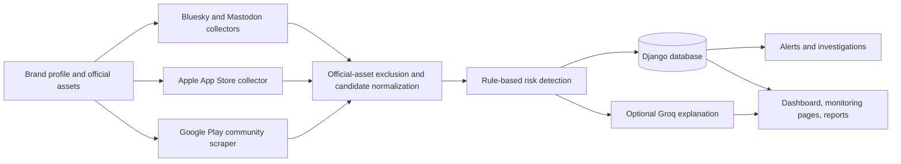

# Digital Risk Protection

A Django prototype for monitoring brand impersonation on public social profiles and the Apple App Store. It combines official brand assets, source collectors, deterministic risk signals, optional AI explanations, and an investigation workflow.

## Quick start

1. Create and activate a virtual environment.
2. Install dependencies: `pip install -r requirements.txt`
3. Copy `.env.example` to `.env`. Set a unique `SECRET_KEY` and keep `.env` private.
4. Initialize the database: `python manage.py migrate`
5. Create an analyst account at `/accounts/register/` or an administrator with `python manage.py createsuperuser`.
6. Start the server: `python manage.py runserver`

Use `/dashboard/` after signing in. Add a brand profile and configure its official accounts and applications before running a scan.

## Monitoring sources

- **Social profiles:** searches public Bluesky actors and account results from the Mastodon instances listed in `MASTODON_INSTANCES` (comma-separated hostnames). Instagram, Facebook, X, LinkedIn, YouTube, and TikTok can be added as manually monitored profiles; they are scored but are not automatically discovered without appropriate platform API access.
- **Mobile applications:** searches Apple's public App Store Search API and Google Play through the `google-play-scraper` community library. Set `APPLE_APP_STORE_COUNTRY`, `GOOGLE_PLAY_COUNTRY`, and `GOOGLE_PLAY_LANGUAGE` to select storefront and language. Google does not provide a free official public catalog-search API; its scraper may be affected by page changes or rate limits. Results are candidate matches, not proof of impersonation. Official app IDs, package names, and store URLs in the brand profile are excluded.
- Both monitoring pages offer source scans and manual candidate entry. Provider failures are surfaced in the UI; social scans may complete with a warning if only one provider is unavailable.

### Live polling and scheduled monitoring

For a continuous polling process, start the web server in one terminal and run `python manage.py monitor_live --interval 900` in another. It scans enabled social, Apple App Store, and Google Play sources every 15 minutes, records findings for the dashboard, and continues after provider errors. The minimum interval is 60 seconds. Stop the polling process with Ctrl+C. The dashboard refreshes its current results every 60 seconds.

To run each cycle as a separate Windows scheduled task instead, register `python manage.py scan_brands` with Windows Task Scheduler:

1. Open **Task Scheduler** and create a task named `Digital Risk Protection scan`.
2. On **Triggers**, create a daily trigger and choose **Repeat task every 15 minutes** for **Indefinitely**.
3. On **Actions**, choose **Start a program**. Set **Program/script** to your Python executable (use your virtual environment's `python.exe` if applicable), **Add arguments** to `manage.py scan_brands`, and **Start in** to the project directory containing `manage.py`.
4. Save the task and use **Run** once to verify it. The task scans all brands with social, Apple App Store, or Google Play monitoring enabled, persists findings and alerts through the same scan service, and reports provider failures in its task output/history.

To run one scan manually, use `python manage.py scan_brands`. Optional flags include `--brand-id 1`, `--source google_play`, and `--limit 10`. This is scheduled polling, not instant event-driven detection; availability and scan freshness depend on provider access and the polling process or task running successfully. Instagram, Facebook, X, LinkedIn, YouTube, and TikTok remain manually tracked unless API access is configured.

Configure the brand's official social profile URLs and official app identifiers (Android package/bundle IDs, App Store listing URLs, or Apple numeric IDs). These assets are excluded from candidate storage or scoring as appropriate. Add official domains, publisher names, and a logo to improve filtering and risk signals. Name similarity, copied description text, suspicious URLs, publisher differences, and app artwork can contribute to a candidate's deterministic risk score. Scoring is a triage aid, not proof of abuse.

## Architecture

Collectors use bounded public-source requests. Official profile URLs and app identifiers are checked before candidate storage; official domains are excluded before scoring and AI analysis. Findings, alerts, and investigation notes are stored in the application's database and scoped to the owning account.

## Demo flow

1. Register and sign in, then create a brand with its official account URL, app identifier, publisher, domain, and logo.
2. Run the Social scan and Apple App Store or Google Play scan from the brand or monitoring pages; if a provider is unavailable, demonstrate the surfaced warning or add a candidate manually.
3. Open a finding to review its evidence and score, then inspect the alert and set its investigation status and notes.
4. Show the dashboard, filtered alert list, and CSV export. Explain that the optional AI summary supports analyst triage and never replaces the deterministic score.

## AI analysis

Set `GROQ_API_KEY` in `.env` to enable optional analysis. `GROQ_MODEL` selects the model. Rule-based scoring remains authoritative; AI adds an evidence summary and a recommendation and does not alter the score. Only the top three high-risk matches per scan receive AI analysis. The monitored item's name, URL, publisher, description/content, configured brand identifiers, and detected signals may be sent to Groq. Review provider data-handling terms before using real or sensitive data. Without a key, or if the provider is unavailable, scans still complete with a visible AI status.

## Main routes

- `/brands/`: create, view, edit, and scan brand profiles.
- `/monitoring/social/` and `/monitoring/apps/`: discover, manually add, filter, and scan candidates.
- `/monitoring/api/scan/`: authenticated source scan endpoint.
- `/detection/analysis/` and `/detection/api/findings/`: inspect risk findings; `POST /detection/api/findings/scan/` scores an owned monitored item and may add an AI explanation.
- `/alerts/`: filter alerts and update investigation status and notes.
- `/correlation/`: view the account-scoped threat graph.
- `/reports/` and `/reports/findings.csv`: review and export findings.
- `/dashboard/`: account-scoped risk and investigation metrics.

All application pages and APIs require authentication except registration and public landing pages. Queries are scoped to the signed-in user's brands.

## Tests

Run the suite with `python manage.py test`.

## Netlify implementation (parallel deployment)

The Netlify version lives alongside the Django application; it does not replace or migrate the Django database.

1. Install Node.js 22 or newer and run `npm install`.
2. Link a Netlify site with `npx netlify link`.
3. In that site's **Identity** settings, enable Identity (or run `npm run identity:enable` to open the correct settings page).
4. Enable Netlify Database for the site. Netlify applies SQL migrations in `netlify/database/migrations` during deploys.
5. Run `npm run db:generate` after schema changes, `npm test`, and `npm run build`.
6. Run the Netlify app locally with `npm run dev`, or deploy the repository to Netlify. The Netlify static app is built into `dist`; Django continues to run separately with `python manage.py runserver`.

Identity enablement is a site-level action: the helper opens the selected site's settings but cannot enable a service in a Netlify account without the user completing that action in the dashboard. Set `NETLIFY_SITE_ID` or link the project before running it. When developing locally without a linked Identity site, the sign-in page links to the Django account pages on port 8002; start Django with `python manage.py runserver 8002` to use this fallback. In a deployed Netlify app, enable Identity for the site. If account confirmation is required, confirm by email before signing in.

The Netlify app currently supports brand registration, owner-scoped dashboards, manual findings/alerts, and public Bluesky, Mastodon, Apple App Store, and Google Play scans. It uses Netlify Identity for authentication and Netlify Database/Postgres for persistence. Review provider terms and deploy-time Identity/Database configuration before using production data.
